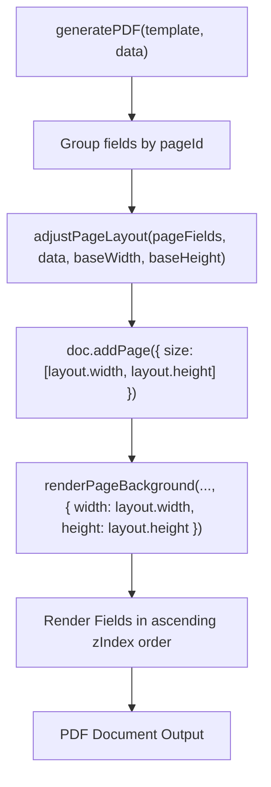

# Dynamic Table Height Modes and Single-Page Expansion

- **Author:** Jaimin Detroja
- **Status:** Proposed
- **Date:** 2026-11-15

---

## Overview

TemplateGoblin generates documents from templates and JSON data. In documents like single-page invoices, summary sheets, and long transactional reports (e.g., bank statements), tables require different height handling strategies:

1. Fixed-boundary clipping for strict physical forms.
2. Single-page vertical expansion that dynamically fits arbitrary data rows onto a single extended page while preserving lower margins and side-by-side elements.
3. Multi-page pagination splitting excess rows across continuation pages with repeating headers and page backgrounds.

This design formalizes the table height mode architecture across the template schema, core rendering pipeline, and visual editor.

## The Problem

Previously, TemplateGoblin supported a binary `multiPage` flag. This created several limitations:

1. **Ambiguous Semantics**: A boolean flag conflated "paginate across continuation pages" with "expand content height". Users who wanted an invoice to expand dynamically onto a single tall page (e.g. for receipts, bills, or continuous viewing) were forced to either clip content or accept unwanted multi-page document splits.
2. **Layout Distortions Below Dynamic Tables**: When a table grew dynamically, content below it collided with expanding rows or suffered margin distortion.
3. **Multi-Table Fragility**: Templates containing side-by-side or parallel tables could not expand independently; naive height adjustments accumulated deltas sequentially, resulting in excessive blank space and shifted sidebars.
4. **Editor Friction**: The visual builder lacked clear affordances for dynamic height behavior. Designers drew static rectangles with no visual indication that the table would expand vertically at runtime.

## Goals

- **Explicit Mode Typing**: Define `TableHeightMode` (`'fixed'`, `'single_page_dynamic'`, `'multipage'`) with seamless backward compatibility for legacy `multiPage: boolean` templates.
- **Single-Page Dynamic Layout Guarantee**: Automatically calculate the required table height at PDF generation time, expand the page height accordingly, and shift lower content down to preserve design margins.
- **Side-by-Side Table Independence**: Support multiple dynamic tables on the same page such that parallel tables expand to their individual needed heights without double-counting vertical deltas.
- **Layout Isolation for Parallel Content**: Ensure elements positioned horizontally alongside dynamic tables stay anchored at their top coordinates.
- **Background Adaptation**: Automatically stretch page background images to match dynamically expanded page heights.
- **Editor Usability**: Default dynamic table creation in the visual playground directly to `single_page_dynamic`, displaying distinct boundary indicators (double-dashed line and expand badge) on the design canvas.

## Non-Goals

- **Horizontal Auto-Sizing**: Dynamic column width calculation based on cell string length is out of scope; columns retain designer-defined widths or fit-to-content proportions.
- **Cross-Page Splitting for Single-Page Dynamic Tables**: `single_page_dynamic` by definition guarantees single-page output; splitting across pages remains exclusive to `multipage`.
- **Arbitrary Element Flow Layouts**: Full CSS flexbox/grid reflow of all canvas elements is out of scope; shifting is strictly vertical push-down based on bounding box tiers.

## Open Questions

- None currently open; foundational constraints (stretch background, full-width slice push-down, cluster-based side-by-side expansion, default playground selection) were aligned during brainstorming.

---

## Critical User Journeys (CUJs)

### CUJ 1: Designing an Invoice with Single-Page Dynamic Height in the Visual Builder

- **Given**: A user is designing an invoice template in `template-goblin-ui` with a company header, an items table, a side payment QR code, and total/signature notes below.
- **When**: The user draws a new table on the canvas.
- **Then**: The creation popup pre-selects `single_page_dynamic` mode automatically. On the canvas, the table renders with double-dashed bottom boundary lines and a `⤓ Dynamic Height (Auto-expands)` badge.

### CUJ 2: Programmatic Generation with Single-Page Dynamic Expansion

- **Given**: A backend service receives a template with a `single_page_dynamic` table and a payload with 30 items.
- **When**: The service calls `generatePDF(template, data)`.
- **Then**: The layout engine calculates the exact row height, expands the table height and overall page height, preserves the side payment box at its top coordinate, shifts the total and signature fields down by the table's net expansion, and stretches the background image to cover the single tall page.

### CUJ 3: Multi-Page Statement Pagination

- **Given**: A user sets `heightMode: 'multipage'` on a table (or legacy `multiPage: true`).
- **When**: The generator receives hundreds or thousands of transaction rows.
- **Then**:
  - The table automatically creates continuation pages to accommodate all rows without clipping.
  - Trailing elements positioned below the table on the authoring page render on the final continuation page below the table's finish.
  - Subsequent pages in `manifest.pages` append strictly after the table finishes.
  - Multi-page rendering applies a default safety ceiling of 500 pages (`options.maxRenderPages ?? 500`), which developers can raise or disable (e.g. `{ maxRenderPages: 1000 }` or `{ maxRenderPages: Infinity }`).

---

## Technical Plan (Architecture)

### 1. Data Contracts (`packages/types`)

Extend the table styling schema with explicit height mode definitions while preserving backward compatibility:

```ts
export type TableHeightMode = 'fixed' | 'single_page_dynamic' | 'multipage'

export interface TableFieldStyle {
  heightMode?: TableHeightMode
  multiPage?: boolean // legacy fallback
  // ... other styling properties
}

export function resolveTableHeightMode(style?: {
  heightMode?: TableHeightMode
  multiPage?: boolean
}): TableHeightMode {
  if (style?.heightMode) return style.heightMode
  return style?.multiPage ? 'multipage' : 'fixed'
}
```

### 2. Dynamic Layout Engine (`packages/core/src/utils/dynamicLayout.ts`)

The layout engine executes prior to PDFKit page creation:

```text
Input Fields + JSON Data + Base Dimensions
                │
                ▼
1. Detect Dynamic Tables (heightMode === 'single_page_dynamic')
                │
                ▼
2. Group Tables into Vertical Clusters (overlapping original Y spans)
                │
                ▼
3. For Each Cluster in Vertical Order:
   - Calculate rendered height: headerHeight + (rowCount * rowHeight)
   - Set table.y = orig.y + accumulatedShift
   - Set table.height = max(orig.height, renderedHeight)
   - Determine clusterMaxNewBottom = max(t.y + t.height)
   - Calculate clusterDelta = max(0, clusterMaxNewBottom - (origBottom + accumulatedShift))
   - accumulatedShift += clusterDelta
                │
                ▼
4. Shift Non-Dynamic Fields:
   - If orig.y >= cluster.origBottom: shift += cluster.delta
   - Else (aside or above): shift += 0 (stay anchored)
                │
                ▼
5. Output Page Dimensions:
   - Page Height = baseHeight + accumulatedShift
```

### 3. Rendering Pipeline Integration (`packages/core/src/generate.ts`)



### 4. Visual Canvas Indicators (`packages/ui/src/components/Canvas`)

- **Field Creation**: `FieldCreationPopup` initializes `tableHeightMode` to `'single_page_dynamic'` for dynamic tables and `'fixed'` for static tables.
- **Canvas Decorators**: `tableDynamicIndicator.ts` renders non-selectable Fabric.js objects on the canvas:
  - Top and bottom dashed boundary lines (`strokeDashArray: [6, 3]`).
  - Centered bottom pill badge (`⤓ Dynamic Height (Auto-expands)`).

---

## Alternatives Considered

### Alternative A: Overloading `multiPage: boolean` Flag

- **Pros**: Requires no schema changes or enum type migrations in `@template-goblin/types`.
- **Cons**: Cannot distinguish between clipping rows at fixed height, splitting across multiple physical continuation pages, and extending a single page's height.
- **Reason for Rejection**: Rejected by author: A boolean flag creates semantic ambiguity and cannot support single-page dynamic layouts alongside multi-page pagination.

### Alternative B: Sequential Accumulation of Deltas for Parallel Tables

- **Pros**: Simple linear loop that applies `delta = renderedHeight - origHeight` for each table sequentially.
- **Cons**: If Table A needs +100pt and Table B needs +200pt side-by-side, sequential accumulation shifts lower elements by +300pt rather than +200pt, producing artificial blank space and oversized documents.
- **Reason for Rejection**: Rejected by author: Side-by-side tables must expand independently to their required heights, and lower content must only be shifted by the maximum bottom reach of the parallel cluster.

### Alternative C: Cropping or Tiling Background Images on Dynamic Expansion

- **Pros**: Preserves the original 1:1 aspect ratio of uploaded background image assets.
- **Cons**: Leaves unpainted white gaps or disjointed repetition seams on expanded documents like invoices and receipts.
- **Reason for Rejection**: Rejected by author: The background image must stretch to match the expanded page dimensions (`[layout.width, layout.height]`) to ensure seamless document appearance.

### Alternative D: Forcing Manual Mode Selection on Table Creation

- **Pros**: Forces explicit designer confirmation of table height behavior before placing the field.
- **Cons**: Adds dialog friction and slows down template design workflows.
- **Reason for Rejection**: Rejected by author: Dynamic tables should default directly to `single_page_dynamic` upon drawing, aligning with the predominant single-page dynamic invoice use case while still permitting changes via the properties panel.

---

## Detailed Implementation Plan

The implementation is partitioned into four sequential phases, where each phase leaves the codebase in a stable, buildable, and testable state.

### Phase 1: Shared Schema & Types (`@template-goblin/types`)

**Objective**: Formalize explicit table height mode types and resolution helpers while preserving legacy boolean compatibility.

#### 1. `packages/types/src/tableHeight.ts` (Create)

- **Type / Scope**: TypeScript Types & Resolution Helpers
- **Implementation**:

  ```ts
  export type TableHeightMode = 'fixed' | 'single_page_dynamic' | 'multipage'

  export function resolveTableHeightMode(style?: {
    heightMode?: TableHeightMode
    multiPage?: boolean
  }): TableHeightMode {
    if (style?.heightMode) return style.heightMode
    return style?.multiPage ? 'multipage' : 'fixed'
  }
  ```

#### 2. `packages/types/src/table.ts` (Modify)

- **Type / Scope**: Schema Interface Definition
- **Implementation**: Add optional `heightMode?: TableHeightMode` to `TableFieldStyle`.

#### 3. `packages/types/src/template.ts` (Modify)

- **Type / Scope**: Types Sub-Barrel Re-export
- **Implementation**: Re-export `TableHeightMode` and `resolveTableHeightMode` through the template types interface.

#### 4. `packages/types/src/index.ts` (Modify)

- **Type / Scope**: Package Public Barrel Export
- **Implementation**: Re-export `TableHeightMode` and `resolveTableHeightMode` for public consumers.

**Phase 1 Verification Checkpoint**:

```bash
pnpm --filter @template-goblin/types type-check
pnpm --filter @template-goblin/types build
```

---

### Phase 2: Core Dynamic Layout Engine & PDF Generator (`template-goblin`)

**Objective**: Implement single-page dynamic table height calculation, interval-based table clustering, lower-element push-down, and stretched background rendering.

#### 5. `packages/core/src/utils/dynamicLayout.ts` (Create)

- **Type / Scope**: Layout Computation Module
- **Contracts & Signatures**:

  ```ts
  export interface PageLayoutResult {
    width: number
    height: number
    fields: FieldDefinition[]
  }

  export function computeTableRenderedHeight(
    field: FieldDefinition,
    data: Record<string, unknown>,
  ): number

  export function adjustPageLayout(
    pageFields: FieldDefinition[],
    data: Record<string, unknown>,
    baseWidth: number,
    baseHeight: number,
  ): PageLayoutResult
  ```

- **Implementation Details**:
  - **Mutation Policy**: `adjustPageLayout` must return deep-cloned field objects so original template definitions remain immutable.
  - **Row Height Helper**: Reuse `cellRowHeight` from `packages/core/src/render/tableStyle.ts` to compute row heights consistently.
  - **Data Resolution**: Extract rows from `data.tables?.[jsonKey]` or root array for dynamic tables; extract from `field.source.value` for static tables. Include header height when `field.style.showHeader !== false`.
  - **Clustering Algorithm**: Group overlapping dynamic tables (`heightMode === 'single_page_dynamic'`) into vertical clusters. Calculate net expansion as `clusterDelta = max(clusterMaxNewBottom - (origBottom + accumulatedShift), 0)`.
  - **Push-Down Rules**: Elements strictly below `cluster.origBottom` receive `clusterDelta`. Elements overlapping or above remain anchored at original `y`.

#### 6. `packages/core/src/generate.ts` (Modify)

- **Type / Scope**: PDF Rendering Orchestrator
- **Implementation**: Invoke `adjustPageLayout` prior to calling `doc.addPage({ size: [layout.width, layout.height] })`. Pass `layout` dimensions to background rendering and render cloned fields in ascending z-index order.

#### 7. `packages/core/src/render/page.ts` & `packages/core/src/render/background.ts` (Modify)

- **Type / Scope**: Page Background Rendering
- **Signature & Behavior**:

  ```ts
  export function renderPageBackground(
    doc: PDFKit.PDFDocument,
    page: PageDefinition,
    data: Record<string, unknown>,
    pageSizeOverride?: { width: number; height: number },
  ): void

  export function renderBackground(
    doc: PDFKit.PDFDocument,
    background: BackgroundDefinition,
    pageSizeOverride?: { width: number; height: number },
  ): void
  ```

  Stretch background image buffers and solid color rectangles across `pageSizeOverride` when provided.

#### 8. `packages/core/tests/dynamicTableHeight.test.ts` (Create)

- **Type / Scope**: Integration Test Driver
- **Concrete Test Scenarios**:
  - _Dynamic Expansion_: Table (orig height 100pt, 10 rows $\times$ 20pt = 200pt) $\rightarrow$ page height expands by 100pt; element at $y=150$ shifts to $y=250$.
  - _Multi-Page Pagination_: Table with `heightMode: 'multipage'` splits across continuation pages with repeated headers.
  - _Fixed Height Clipping_: Table with `heightMode: 'fixed'` clips content without page height alteration.
  - _Empty Data Edge Case_: 0 rows or missing JSON key renders at header/original height; page does not expand.

#### 9. `packages/core/tests/sideBySideDynamicTables.test.ts` (Create)

- **Type / Scope**: Core Layout Unit Test Driver
- **Concrete Test Scenarios**:
  - _Clustering Without Delta Accumulation_: Table A (+50pt) and Table B (+120pt) side-by-side $\rightarrow$ lower elements shift by $\max(50, 120) = 120\text{pt}$ instead of $170\text{pt}$.
  - _Aside Element Anchoring_: Element beside dynamic tables ($y < \text{cluster.origBottom}$) maintains original $y$ ($+0\text{pt}$).

**Phase 2 Verification Checkpoint**:

```bash
pnpm --filter template-goblin test
```

---

### Phase 3: Visual Canvas Decorators & Property Inspector (`template-goblin-ui`)

**Objective**: Provide visual indicators on the canvas, seamless creation defaults, and mode controls in the inspector without breaching line-count limits.

#### 10. `packages/ui/src/components/Canvas/FieldCreationTypes.ts` (Modify)

- **Type / Scope**: Creation Dialog Types
- **Implementation**: Extend `SourceInputs` to include `tableHeightMode?: TableHeightMode`.

#### 11. `packages/ui/src/components/Canvas/FieldCreationPopup.tsx` (Modify)

- **Type / Scope**: Visual Builder Dialog
- **Implementation & Constraints**:
  - Default `tableHeightMode` to `'single_page_dynamic'` for dynamic tables and `'fixed'` for static tables.
  - Preserve required field validation for labels and JSON keys.
  - Keep file strictly under 300 lines by delegating mode selector UI to child component `TableHeightModePicker.tsx`.

#### 12. `packages/ui/src/components/Canvas/useFieldCreationPopup.ts` (Modify)

- **Type / Scope**: Creation Store Action Hook
- **Implementation**: Map `source.tableHeightMode` to field creation payload (`field.style.heightMode` and `field.style.multiPage = tableHeightMode === 'multipage'`).

#### 13. `packages/ui/src/components/Canvas/TableHeightModePicker.tsx` (Create)

- **Type / Scope**: UI Segmented Selector Component
- **Props Contract**:
  ```ts
  export interface TableHeightModePickerProps {
    value: TableHeightMode
    onChange: (mode: TableHeightMode) => void
    disabled?: boolean
  }
  ```
  Render 3-way segmented radio control with info button opening `TableHeightHelpModal`.

#### 14. `packages/ui/src/components/Canvas/TableHeightHelpModal.tsx` (Create)

- **Type / Scope**: Informational Dialog Component
- **Implementation**: Modal dialog detailing differences between Fixed, Single Page Dynamic, and Multi-Page modes with visual comparison diagrams.

#### 15. `packages/ui/src/components/Canvas/tableDynamicIndicator.ts` (Create)

- **Type / Scope**: Fabric.js Canvas Decorator
- **Signatures & Behavior**:
  ```ts
  export function buildDynamicTableIndicators(
    field: TableField,
    width: number,
    height: number,
  ): fabric.Object[]
  ```
  Construct top/bottom dashed lines (`strokeDashArray: [6, 3]`) and bottom pill badge (`⤓ Dynamic Height (Auto-expands)`).

#### 16. `packages/ui/src/components/Canvas/tableCanvasParts.ts` (Modify)

- **Type / Scope**: Fabric Group Assembly
- **Implementation**: Mount `buildDynamicTableIndicators` children when table field has `heightMode === 'single_page_dynamic'`.

#### 17. `packages/ui/src/components/RightPanel/LoopFieldProps.tsx` (Modify)

- **Type / Scope**: Properties Inspector Sidebar
- **Implementation & Invariants**:
  - Provide toggle controls to view and update table height mode for selected tables.
  - **Synchronization Invariant**: Updating `heightMode` must synchronously update `multiPage: newMode === 'multipage'`.

#### 18. `packages/ui/src/components/Canvas/__tests__/tableHeightFeatures.test.ts` (Create)

- **Type / Scope**: UI Unit Test Driver
- **Concrete Test Scenarios**:
  - Fallback resolution for legacy `multiPage: boolean` templates.
  - Creation popup defaults dynamic tables to `single_page_dynamic`.
  - Indicator elements attached to dynamic table Fabric groups.

**Phase 3 Verification Checkpoint**:

```bash
pnpm --filter template-goblin-ui test
```

---

### Phase 4: Component Contracts & Monorepo Verification

**Objective**: Keep directory README contracts synchronized, maintain strict line bounds, and run master QA checks.

#### 19. Component Contract Documentation (Modify)

- **Target Paths**:
  - `packages/core/src/utils/README.md`
  - `packages/core/README.md`
  - `packages/ui/README.md`
  - `packages/types/README.md`
- **Implementation**: Synchronize public interfaces, system invariants (clustering behavior, background stretching, 300-line limits), side effects, and verification commands with the new height mode capabilities.

**Phase 4 Verification Checkpoint**:

```bash
npx prettier --check "packages/**/*.{ts,tsx,md}"
pnpm lint
pnpm --filter @template-goblin/types build
pnpm --filter template-goblin build
pnpm --filter template-goblin-ui build
pnpm --filter template-goblin test
pnpm --filter template-goblin-ui test
```

---

## Verification Plan

- **Compilation & Type Safety**:
  ```bash
  pnpm --filter @template-goblin/types type-check
  pnpm --filter template-goblin build
  pnpm --filter template-goblin-ui build
  ```
- **Core Unit & Integration Testing**:
  ```bash
  pnpm --filter template-goblin test
  ```
  Must pass all core test suites, including `dynamicTableHeight.test.ts` and `sideBySideDynamicTables.test.ts`.
- **UI Unit Testing**:
  ```bash
  pnpm --filter template-goblin-ui test
  ```
  Must pass all UI test suites, including `tableHeightFeatures.test.ts`.
- **Code Quality & Formatting**:
  ```bash
  npx prettier --check "packages/**/*.{ts,tsx,md}"
  pnpm lint
  ```
- **Source Line Bounds**:
  No source file may exceed 300 lines; decompose large components such as `FieldCreationPopup.tsx` into focused subcomponents.
